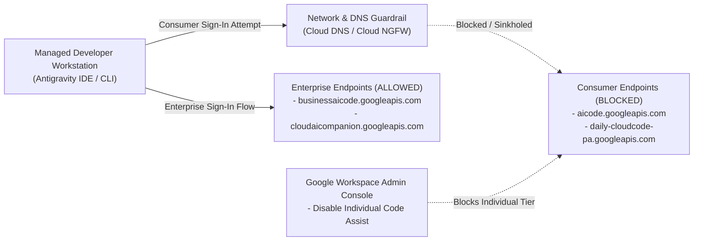

# Antigravity for Enterprise: Blocking Consumer Access & Enforcing Cloud ToS

This package provides an automated script (`block_antigravity_consumer.sh`) and step-by-step operational guide to ensure your organization's developers authenticate exclusively through the **Antigravity Enterprise login flow** (governed by the **Google Cloud Terms of Service**) and cannot accidentally sign in through the consumer login flow.

---

## Why This Matters

Antigravity supports two sign-in paths. A developer who signs in with a personal account lands under consumer terms and is not covered by your Google Cloud Terms of Service (Cloud ToS):

| Attribute | Consumer Flow | Enterprise Flow |
| :--- | :--- | :--- |
| **Signs in with** | Personal Google account | Organization / managed account (via Gemini Enterprise / Google Cloud) |
| **Governed by** | Consumer Terms of Service | **Google Cloud Terms of Service (Cloud ToS)** |
| **Data governance** | Consumer-grade | Enterprise controls, admin visibility, & audit telemetry |
| **IP indemnification** | Not covered | Covered under Google Cloud terms |
| **Right fit for enterprise?** | No | **Yes** |

### Summary of Controls Implemented



1. **Block Two Consumer API Hostnames at the Network Level**:
   - `aicode.googleapis.com`
   - `daily-cloudcode-pa.googleapis.com`
2. **Disable Antigravity for Individuals in Google Workspace Admin Console**:
   - Disable **Allow access to Code Assist for individuals** at `admin.google.com` ([Documentation](https://docs.cloud.google.com/gemini/docs/codeassist/control-individuals-access)).

---

## Prerequisites

Before running `block_antigravity_consumer.sh`, ensure the following prerequisites are met based on the execution mode(s) you plan to run:

### 1. CLI & Workstation Tools
- **Bash**: Version 4.0 or later (standard on Linux and macOS).
- **Google Cloud SDK (`gcloud`)**: Installed and initialized (`gcloud init` and `gcloud auth login`). Required for `gcp-dns`, `gcp-firewall`, and `all` modes.
- **Connectivity Utilities**: `curl` and `getent` or `dig` (used by `--mode verify`).

### 2. Required Permissions by Control Plane

| Mode | Target Environment | Required Roles / Privileges | Required GCP APIs (Auto-Enabled by Script) |
| :--- | :--- | :--- | :--- |
| **`gcp-dns`** | Google Cloud VPC (Cloud DNS Response Policy) | - `roles/dns.admin` (DNS Administrator)<br/>- `roles/serviceusage.serviceUsageAdmin` | `dns.googleapis.com` |
| **`gcp-firewall`** | Google Cloud VPC (Global Network Firewall Policy Egress FQDN Deny) | - `roles/compute.securityAdmin` (or `roles/compute.orgSecurityPolicyAdmin`)<br/>- `roles/compute.networkAdmin` | `compute.googleapis.com` |
| **Workspace Admin** | Google Workspace Admin Console (`admin.google.com`) | - Google Workspace **Super Admin** or **Services Admin** role with the **Service Settings** privilege | *N/A (Admin Console UI)* |

---

## Execution Steps

### Step 1: Prepare the Script

Ensure the script has executable permissions:

```bash
chmod +x block_antigravity_consumer.sh
```

View all supported flags and options at any time with `--help`:

```bash
./block_antigravity_consumer.sh --help
```

---

### Step 2: Perform a Dry-Run (`--dry-run`) First (Recommended)

The script includes a `--dry-run` flag across every mode (including `--rollback`). In dry-run mode, the script validates your inputs and prints every `gcloud` command it *would* execute without modifying any cloud resources.

#### Preview All Controls (Cloud DNS, Cloud NGFW, and Verification)
```bash
./block_antigravity_consumer.sh \
  --mode all \
  --project-id "<YOUR_GCP_PROJECT_ID>" \
  --principal "<ADMIN_EMAIL_OR_PRINCIPAL>" \
  --networks "<VPC_NETWORK_NAME>" \
  --dry-run
```

> [!NOTE]
> When run interactively without flags (`./block_antigravity_consumer.sh`), the script automatically prompts you for the **Execution Mode**, **Google Cloud Project ID**, **GCP Auth Principal**, and **Target VPC Network(s)** (defaulting to your currently active `gcloud` configuration). If the provided `--principal` is not yet logged in locally, the script automatically initiates `gcloud auth login <PRINCIPAL>` and sets the active `gcloud` account and project.

---

### Step 3: Apply Network-Level Consumer Endpoint Blocks

You can apply the block at the VPC DNS layer, the VPC Firewall layer, or both (`--mode all`):

#### Option A: Block via Google Cloud DNS Response Policy (`gcp-dns`)
Creates a Cloud DNS Response Policy attached to your specified VPC network(s) that sinkholes `aicode.googleapis.com` and `daily-cloudcode-pa.googleapis.com` to `0.0.0.0` (IPv4) and `::` (IPv6):

```bash
# 1. Dry-run preview:
./block_antigravity_consumer.sh \
  --mode gcp-dns \
  --project-id "<YOUR_GCP_PROJECT_ID>" \
  --principal "<ADMIN_EMAIL_OR_PRINCIPAL>" \
  --networks "default,prod-vpc" \
  --dry-run

# 2. Apply live:
./block_antigravity_consumer.sh \
  --mode gcp-dns \
  --project-id "<YOUR_GCP_PROJECT_ID>" \
  --principal "<ADMIN_EMAIL_OR_PRINCIPAL>" \
  --networks "default,prod-vpc"
```

#### Option B: Block via Google Cloud Next Generation Firewall Egress FQDN Rule (`gcp-firewall`)
Creates a Global Network Firewall Policy with an EGRESS `deny` rule targeting `aicode.googleapis.com` and `daily-cloudcode-pa.googleapis.com` on TCP/UDP port 443 and associates it with your VPC network(s):

```bash
# 1. Dry-run preview:
./block_antigravity_consumer.sh \
  --mode gcp-firewall \
  --project-id "<YOUR_GCP_PROJECT_ID>" \
  --principal "<ADMIN_EMAIL_OR_PRINCIPAL>" \
  --networks "default,prod-vpc" \
  --dry-run

# 2. Apply live:
./block_antigravity_consumer.sh \
  --mode gcp-firewall \
  --project-id "<YOUR_GCP_PROJECT_ID>" \
  --principal "<ADMIN_EMAIL_OR_PRINCIPAL>" \
  --networks "default,prod-vpc"
```

---

### Step 4: Disable Antigravity for Individuals in Google Workspace Admin Console

In addition to the network controls above, a Google Workspace Administrator (**Super Admin** or **Services Admin**) should disable individual Code Assist / Antigravity access in the Google Workspace Admin Console:

1. Open the [Google Workspace Admin Console](https://admin.google.com) and sign in with an administrator account.
2. Navigate to **Apps** > **Additional Google Services** > **Google Cloud Platform**.
3. Click the **Code Assist settings** pane.
4. **Uncheck** the box for **Allow access to Code Assist for individuals**.
5. Click **Save**.

*(Reference: [Control access to Gemini Code Assist for individuals](https://docs.cloud.google.com/gemini/docs/codeassist/control-individuals-access))*

---

### Step 5: Verify the Configuration (`verify`)

From an in-scope managed device or workstation inside the target network, run the built-in verification suite:

```bash
./block_antigravity_consumer.sh \
  --mode verify \
  --project-id "<YOUR_GCP_PROJECT_ID>" \
  --principal "<ADMIN_EMAIL_OR_PRINCIPAL>"
```

**What the verification checks:**
1. **Consumer Endpoints Unreachable**: Confirms `https://aicode.googleapis.com` and `https://daily-cloudcode-pa.googleapis.com` fail to connect or resolve to `0.0.0.0` / `::`.
2. **Enterprise Endpoints Unaffected**: Confirms `https://businessaicode.googleapis.com`, `https://cloudaicompanion.googleapis.com`, and `https://generativelanguage.googleapis.com` remain reachable.
3. **GCP Policy Status**: Confirms active Cloud DNS Response Policies and Global Network Firewall Policies on the project.
4. **Client Spot-Check**:
   - Attempt the **Consumer** login flow in Antigravity -> model calls should fail/be unavailable, and no customer data is sent to consumer endpoints.
   - Confirm the **Enterprise** login flow works normally and everyday Antigravity functionality is unaffected.

---

## Rollback / Reversibility (`--rollback`)

All changes made by this script are **fully reversible**. Pass `--rollback` (optionally with `--dry-run` first) to cleanly remove the block rules:

```bash
# Preview rollback in dry-run mode:
./block_antigravity_consumer.sh \
  --mode all \
  --project-id "<YOUR_GCP_PROJECT_ID>" \
  --principal "<ADMIN_EMAIL_OR_PRINCIPAL>" \
  --networks "default,prod-vpc" \
  --rollback --dry-run

# Rollback Cloud DNS sinkhole policy:
./block_antigravity_consumer.sh \
  --mode gcp-dns \
  --project-id "<YOUR_GCP_PROJECT_ID>" \
  --principal "<ADMIN_EMAIL_OR_PRINCIPAL>" \
  --networks "default,prod-vpc" \
  --rollback

# Rollback Cloud NGFW firewall policy:
./block_antigravity_consumer.sh \
  --mode gcp-firewall \
  --project-id "<YOUR_GCP_PROJECT_ID>" \
  --principal "<ADMIN_EMAIL_OR_PRINCIPAL>" \
  --networks "default,prod-vpc" \
  --rollback
```

---

## Frequently Asked Questions (FAQ)

- **Does blocking these endpoints break Enterprise Antigravity?**
  No. Only the consumer sign-in and inference path is blocked; enterprise Antigravity access continues to work normally.
- **Do I need to block the Gemini API endpoint (`generativelanguage.googleapis.com`)?**
  **No.** `generativelanguage.googleapis.com` is not used by the Antigravity consumer login service, and blocking it will not help. The script's `verify` mode explicitly checks that `generativelanguage.googleapis.com` remains reachable.

---

## License

Copyright 2026 Google LLC.

Licensed under the **Apache License, Version 2.0** (the "License"); you may not use these files except in compliance with the License. You may obtain a copy of the License at:

http://www.apache.org/licenses/LICENSE-2.0

Unless required by applicable law or agreed to in writing, software distributed under the License is distributed on an "AS IS" BASIS, WITHOUT WARRANTIES OR CONDITIONS OF ANY KIND, either express or implied. See the License for the specific language governing permissions and limitations under the License.
